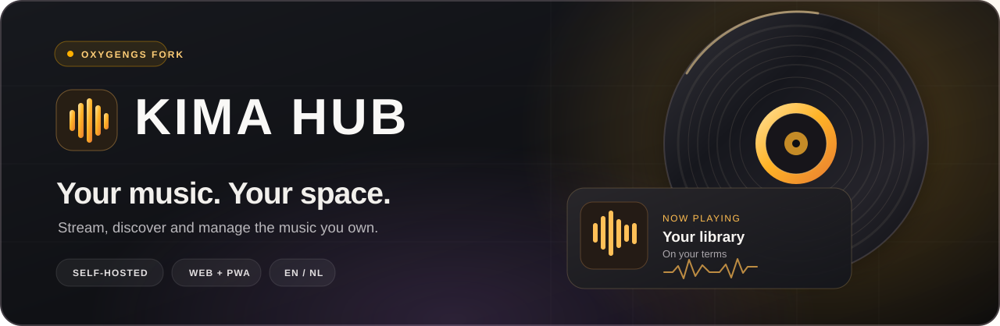
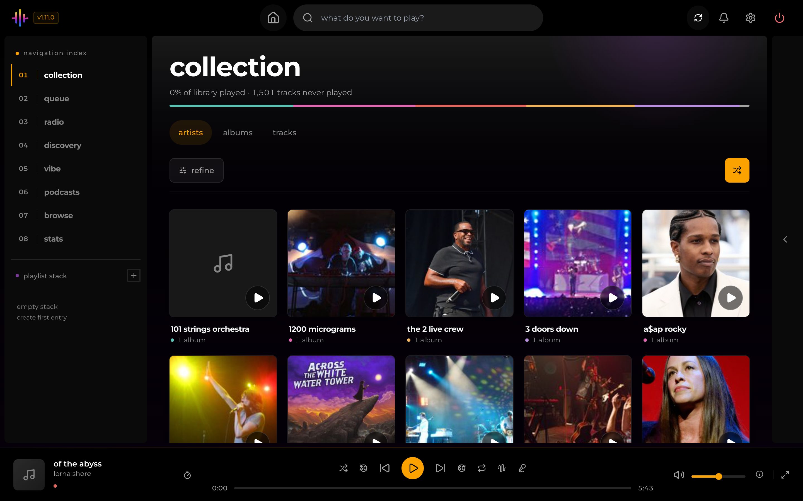
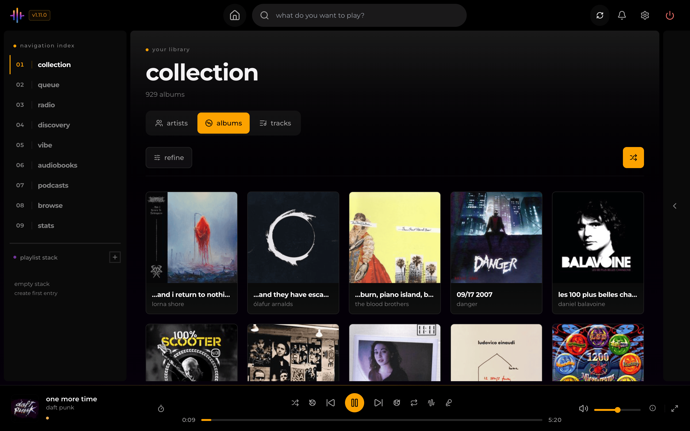
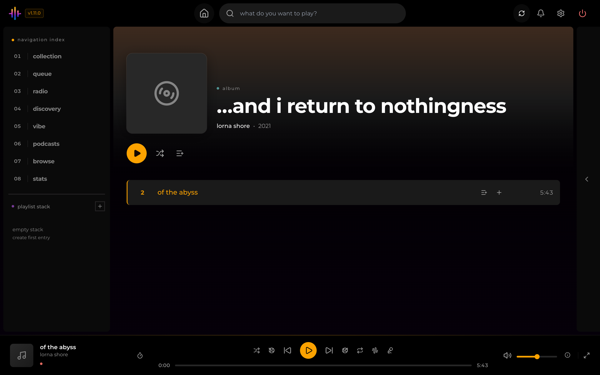
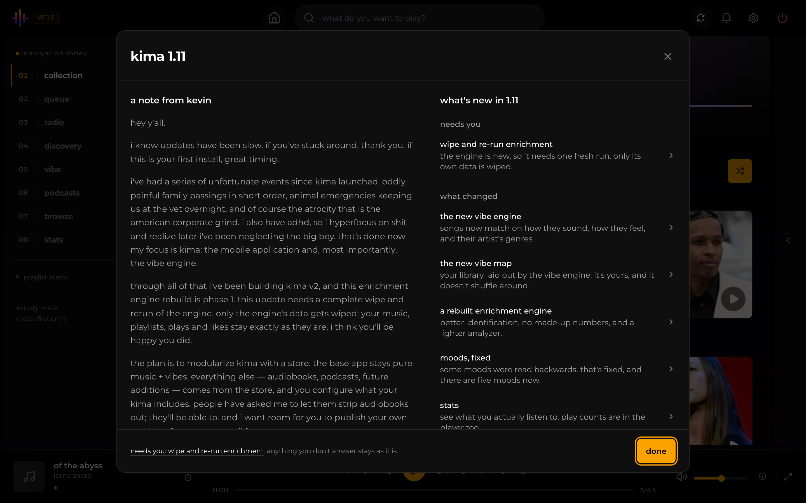
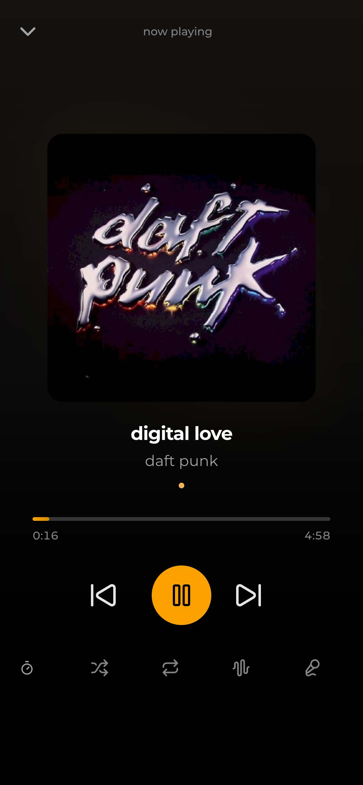
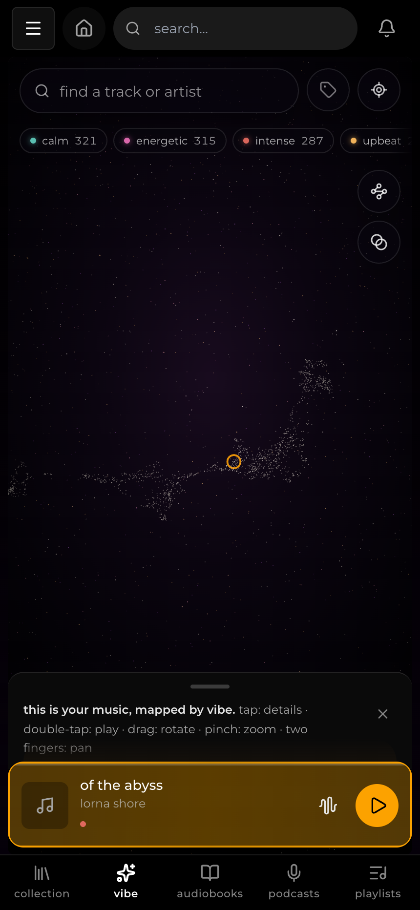

<div align="center">



# Kima Hub

**A beautiful home for the music you own.**

A modern, self-hosted listening experience with a distinctive dark interface, personal discovery, library tools and the freedom to run it all on your own server.

[](https://github.com/OxygenGS/kima-hub/releases/tag/v1.27.0)
[](https://github.com/OxygenGS/kima-hub/pkgs/container/kima-hub)
[](https://github.com/OxygenGS/kima-hub/actions/workflows/docker-publish.yml)
[](docs/internationalization.md)
[](LICENSE)

**[What's new](#whats-new-in-v1270) · [Experience](#the-experience) · [Settings Studio](#settings-studio-20) · [Features](#features) · [Install](#quick-start) · [Docs](#documentation)**

</div>

---

## What's new in v1.27.0

**More control over your listening experience and safer library maintenance.** [Kima Hub v1.27.0](https://github.com/OxygenGS/kima-hub/releases/tag/v1.27.0) was published on **24 November 2026** for Linux **AMD64 and ARM64**.

| New in v1.27.0 | What it does |
| :--- | :--- |
| **Personal Appearance** | Keep original capitalization and choose whether Browse appears in the desktop sidebar, independently per browser. |
| **Audiobook playback speed** | Listen at 0.75×–2× from the book page, desktop player or mobile player. Music and podcasts remain at 1×. |
| **Redis diagnostics** | Investigate startup problems using bounded, read-only AOF checks. No automatic repair, deletion or queue wipe. |
| **OpenSubsonic compatibility** | Recognize common codec and MIME aliases when reporting direct-play decisions. |
| **Artist biography protection** | Keep stored descriptions when enrichment has no valid replacement. |

No new database migration is introduced by v1.27.0. Keep your existing Compose/Dockge project and media mounts, and verify an independently restorable cold `/data` backup before upgrading.

[Full v1.27.0 release](https://github.com/OxygenGS/kima-hub/releases/tag/v1.27.0) · [Safe upgrade and rollback](docs/safe-aio-updates.md) · [Redis recovery](docs/redis-recovery.md)

### Previously in v1.26.0 — Flow and Music DNA

Kima Flow provides guided local-library mixes, continuous listening and private, reversible Music DNA feedback. Discovery Radar and Album Spotlight help explore new artists without automatically starting downloads; Library Guardian presents possible duplicate-recording evidence without modifying files. The original 3D Vibe Map remains available.

[Full v1.26.0 release](https://github.com/OxygenGS/kima-hub/releases/tag/v1.26.0) · [Using Flow](docs/using-kima.md#kima-flow-v1260) · [Library Doctor](docs/library-doctor.md)

### Previously in v1.25.0 — Kima Connect

Discover your own authenticated browser players, use remote playback controls and transfer a queue with the receiving player's consent. Kima Connect does not control third-party OpenSubsonic clients or provide synchronized multiroom playback.

[v1.25.0 release notes](https://github.com/OxygenGS/kima-hub/releases/tag/v1.25.0) · [Kima Connect guide](docs/project-one.md)

## The experience

One music space for your favorite albums, artists, playlists and discoveries. Built for a personal library rather than a subscription catalog.

<div align="center">
  
  <sub>Home · your library, listening and discoveries together</sub>
</div>

## Settings Studio 2.0

**New in [v1.22.0](https://github.com/OxygenGS/kima-hub/releases/tag/v1.22.0).** The old, endless settings screen is gone. A focused settings workspace now matches the rest of the OxygenGS theme: dark surfaces, warm amber accents, thoughtful spacing and clearer controls.

<div align="center">
  
  <sub>Illustrated preview based on the v1.22.0 interface structure; not a screenshot of a live installation.</sub>
</div>

| Find what matters | Change settings with confidence |
| :--- | :--- |
| **Five areas:** Personal, Appearance, Downloads & services, Music library, Administration. | **One active panel at a time**, rather than a giant page of unrelated options. |
| Searchable desktop navigation and mobile-friendly category shortcuts. | Unsaved inputs remain intact when switching panels, with the existing save workflow. |
| Existing deep links continue to work; obsolete navigation is removed. | Admin-only controls stay permission-restricted; existing service connections and settings APIs are preserved. |

[See all settings](docs/configuration.md) · [Read the v1.22.0 release notes](https://github.com/OxygenGS/kima-hub/releases/tag/v1.22.0)

## Made for your music

### Explore the library

<table>
<tr>
<td width="50%" align="center"><sub>Browse your library</sub></td>
<td width="50%" align="center"><sub>Artists, albums and tracks</sub></td>
</tr>
<tr>
<td width="50%" align="center"><sub>Albums and track lists</sub></td>
<td width="50%" align="center"><sub>Your personal collection</sub></td>
</tr>
</table>

### Find your next favorite

Start with **Kima Flow** for a guided local-library mix, or open **Vibe Map** for a 3D view of audio similarity. **Mood Mixer**, radio and discovery views offer more ways to explore your collection.

<table>
<tr>
<td width="50%" align="center"><sub>Vibe Map · explore relationships between tracks</sub></td>
<td width="50%" align="center"><sub>Mood Mixer · shape the next listening session</sub></td>
</tr>
</table>

Vibe also includes **Match Vibe**, **Song Path** and **Blend** for listening paths and mixes built from audio similarity. [Explore the listening experience](docs/using-kima.md)

### Built for smaller screens, too

<div align="center">
<table>
<tr>
<td width="33%" align="center"></td>
<td width="33%" align="center"></td>
<td width="33%" align="center"></td>
</tr>
<tr><td align="center"><sub>Home</sub></td><td align="center"><sub>Player</sub></td><td align="center"><sub>Vibe</sub></td></tr>
</table>
</div>

Responsive desktop and mobile layouts, installable browser-based PWA support and a dedicated television-browser layout. Existing repository screenshots are illustrative of product features and may differ slightly from the latest release.

## Features

| Listen & discover | Own & manage |
| :--- | :--- |
| **Music playback** — queue, shuffle, repeat, lyrics, playlists, radio and sleep timer. | **Local music library** — keep your own files and use your own storage paths. |
| **Personal discovery** — Mood Mixer, Vibe Map, Similar, Song Path, Blend and listening stats. | **Library Doctor** — inspect missing tracks, album associations and library health. |
| **Kima Flow** — guided, explainable local-library mixes with optional continuous queue refill. | **Music DNA** — private, reversible per-track taste feedback. |
| **Discovery Radar & Album Spotlight** — opt-in discovery of similar artists and source-backed albums. | **Library Guardian** — admin-only, read-only evidence for possible duplicate recordings. |
| **Playlists** — make, reorder, share and import from supported links or M3U. | **Artwork tools** — repair missing artist imagery and album covers without overwriting curated artwork. |
| **Podcasts and audiobooks** — podcast subscriptions and optional Audiobookshelf playback. | **Downloads** — per-user Kima job history with optional Lidarr and Soulseek workflows. |
| **Modern music clients** — compatible OpenSubsonic players, including Symfonium and Feishin. | **Server controls** — separate users and roles, 2FA, branding, language and audio quality settings. |
| **Kima Connect** — private browser-device discovery, consent-based queue transfer and remote playback control. | **Safe handoff** — playback confirmation, bounded Redis commands, timeout recovery and SSE fallback. |

### Connect the tools you already use

| Integration | What it adds |
| :--- | :--- |
| **Lidarr** | Request albums using your existing automation and library-import workflow. |
| **Soulseek / slskd** | Search for and download individual tracks using the built-in client or an external slskd server. |
| **OpenSubsonic** | Connect compatible music apps, including **Symfonium** and **Feishin**; per-client Native Apps keys support modern authentication without requiring legacy login modes. |
| **Audiobookshelf** | Bring audiobooks and podcast libraries into your listening space. |
| **ListenBrainz** | Optional scrobbling and listening-related recommendations. |
| **Fanart.tv / AcoustID** | Optional artwork enrichment and audio identification. |

Services are optional: Kima runs as a self-hosted music server without requiring Lidarr, Soulseek or Audiobookshelf. The experimental **Downtify connector was retired in v1.21.0** and is **not** part of the current app; previously imported files and historical database records are preserved.

[Integration guide](docs/integrations.md) · [Native music clients](docs/subsonic.md) · [Library Doctor](docs/library-doctor.md) · [Privacy](PRIVACY.md)

## Quick start

**Current stable release:** [v1.27.0](https://github.com/OxygenGS/kima-hub/releases/tag/v1.27.0) (24 November 2026) · **Platforms:** `linux/amd64` and `linux/arm64`.

**Versioned image:** `ghcr.io/oxygengs/kima-hub:v1.27.0`

The all-in-one image includes the web interface, API, PostgreSQL, Redis and audio-analysis services. Your music stays in a host-mounted directory; persistent application data lives in `/data`. Lidarr and Soulseek are optional integrations.

### Docker — new installations

```bash
docker run -d \
  --name kima \
  --restart unless-stopped \
  -p 3030:3030 \
  -v /absolute/path/to/music:/music \
  -v kima_data:/data \
  ghcr.io/oxygengs/kima-hub:v1.27.0
```

Replace `/absolute/path/to/music` with the **existing, correctly mounted** host directory containing your music. Open `http://localhost:3030` on the Docker host to complete setup. Restrict external access unless appropriate security controls are in place.

### Docker Compose / Dockge — new installations

The [production Compose example](docker-compose.prod.yml) defaults to the published **v1.27.0** image when `VERSION` is unset, requires `MUSIC_PATH` and does not silently create a missing host music directory.

```bash
MUSIC_PATH=/absolute/path/to/music VERSION=v1.27.0 \
  docker compose -f docker-compose.prod.yml up -d
```

The [optional companion stack](docker-compose.server.yml) includes additional download-management services. [Full installation instructions](docs/install.md)

> [!IMPORTANT]
> **Already running Kima? Do not replace your existing stack with these new-install examples.** Retain your Compose/Dockge project name, pinned image, complete `/data` volume, and existing `/music` and `/downloads` mounts. Before upgrading, stop data writers and verify a **separately restorable cold backup** of `/data`. v1.26.0 adds a Music DNA database table; reverting only the image does not reverse a database migration. See [safe updates and recovery](docs/safe-aio-updates.md).

## Security and release quality

- **v1.27.0 is published.** The [native AMD64/ARM64 preflight](https://github.com/OxygenGS/kima-hub/actions/runs/45379839167), [explicit stable approval](https://github.com/OxygenGS/kima-hub/actions/runs/45384258511) and [multi-architecture Docker publication](https://github.com/OxygenGS/kima-hub/actions/runs/45384297510) succeeded. Publication does **not** automatically upgrade running installations or promote the `:latest` alias.
- **Residual vulnerabilities remain.** The v1.27.0 Trivy preflight reported **391 HIGH / 8 CRITICAL** findings on AMD64 and **390 HIGH / 8 CRITICAL** on ARM64, with no scanner-listed fixed versions. A passing build or publication approval does not establish that affected code is unreachable or safe.
- Restrict unnecessary internet exposure, update your host and reverse proxy, protect credentials and verify a **separately restorable cold `/data` backup** before upgrading.

[Security policy](SECURITY.md) · [Image-security report](docs/image-security.md) · [Safe AIO upgrades](docs/safe-aio-updates.md) · [Privacy policy](PRIVACY.md)

## Documentation

| Start exploring | Operate and improve |
| :--- | :--- |
| [Install & upgrade](docs/install.md) | [Settings Studio & configuration](docs/configuration.md) |
| [Using Kima](docs/using-kima.md) | [Administration](docs/administration.md) |
| [Integrations](docs/integrations.md) | [Library health & repairs](docs/library-doctor.md) |
| [Symfonium, Feishin & OpenSubsonic](docs/subsonic.md) | [Image security](docs/image-security.md) |
| [User permissions](docs/user-permissions.md) | [Safe backups & rollback](docs/safe-aio-updates.md) |
| [Full changelog](CHANGELOG.md) | [Development](docs/development.md) |
| [Branding](docs/instance-branding.md) | [Upstream compatibility](docs/upstream-compatibility.md) |

## About the fork

**OxygenGS Kima Hub** is an independent community fork of [Kima Hub by Chevron7Locked](https://github.com/Chevron7Locked/kima-hub), not an official upstream release. The aim is to make a more polished, capable and approachable self-hosted music application while keeping upstream improvements practical to integrate.

Licensed under [GNU GPL v3.0](LICENSE). Original contributions and third-party components remain with their respective owners; see the [audio model notices](services/audio-analyzer/models/LICENSE-upf-models).

<div align="center">

**Your music. Your space. Your server.**

[Releases](https://github.com/OxygenGS/kima-hub/releases) · [Installation](docs/install.md) · [Changelog](CHANGELOG.md)

</div>
