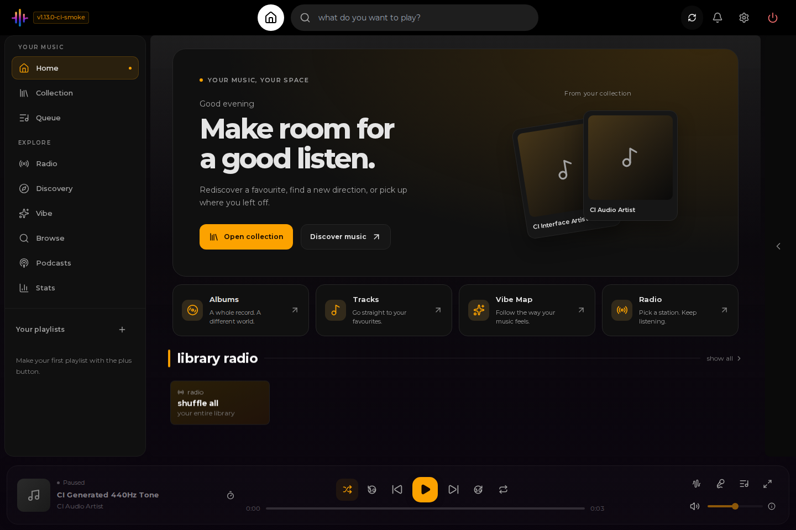
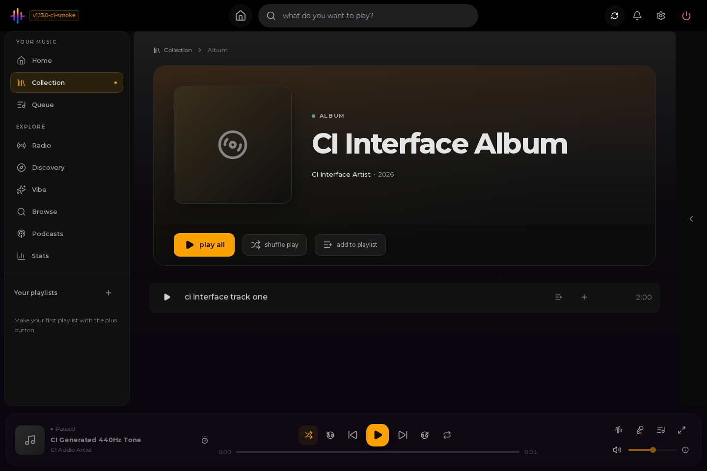
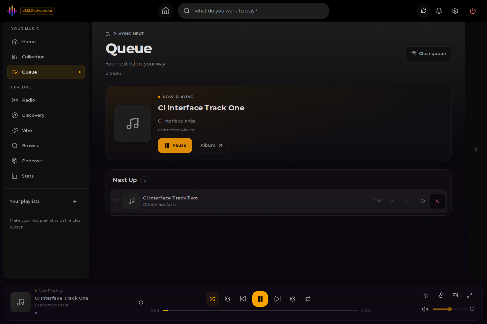
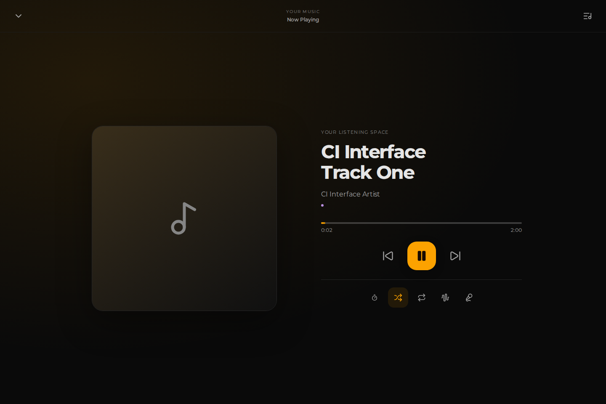
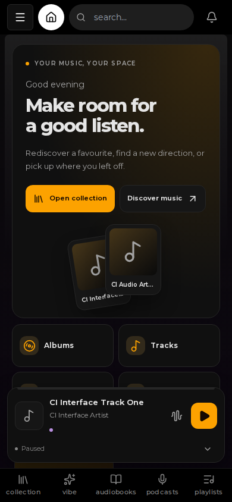
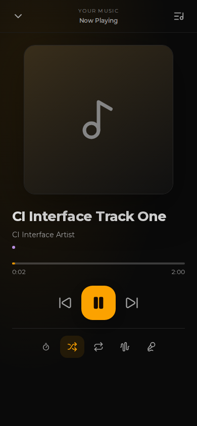
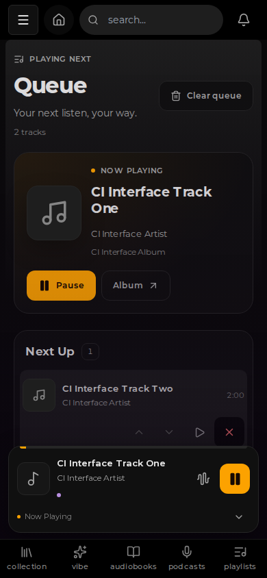

<div align="center">


# Kima Hub - Oxygen's Fork

**Your music, your server — now with smoother artwork and smarter search.**

Stream the albums you own. Rediscover forgotten favorites. Keep your library, accounts and settings on your own server.

[](https://github.com/OxygenGS/kima-hub/releases)
[](https://github.com/OxygenGS/kima-hub/pkgs/container/kima-hub)
[](docs/internationalization.md)
[](LICENSE)

[**What's new**](#new-in-v1140) &nbsp; / &nbsp; [**Screenshots**](#see-the-interface) &nbsp; / &nbsp; [**Install**](#quick-start) &nbsp; / &nbsp; [**Documentation**](#documentation)

</div>

## New in v1.14.0

**[Kima Hub v1.14.0 is released](https://github.com/OxygenGS/kima-hub/releases/tag/v1.14.0).** This update builds on the redesigned v1.13 interface and faster artist pages. It improves artwork processing and makes local music search more forgiving without replacing the playback engine.

| Smoother browsing | Smarter library search | Familiar experience |
| :--- | :--- | :--- |
| Local artwork uses non-blocking file operations, reuses concurrent resize work and limits simultaneous cold resizes. | Exact artist, album and song matches rank first; accented and non-Latin names are preserved, with a typo fallback when regular search has no results. | Existing playback, playlists, permissions, English/Dutch UI and modern Symfonium/Feishin authentication stay in place. |

**Before updating:** v1.14.0 adds PostgreSQL `pg_trgm` and three GIN text indexes. Their first-time creation may use extra disk space and I/O, especially on large libraries. **Back up the entire persistent `/data` volume and verify that you can restore it** before changing the image. For rollback, restore the separate pre-upgrade data backup rather than opening migrated data with an older version. See the [safe update guide](docs/safe-aio-updates.md) and [release notes](https://github.com/OxygenGS/kima-hub/releases/tag/v1.14.0).

## New in v1.13.1

**[v1.13.1 is released](https://github.com/OxygenGS/kima-hub/releases/tag/v1.13.1).** Artist pages show locally saved information and playable albums without waiting for external discography or recommendations. External images can still appear later; already cached details remain fast. The existing v1.13 interface, playback and client integrations are preserved.

## New in v1.13.0

**v1.13.0 is released.** This is the visible interface refresh: a new Home, clearer navigation, larger artist and album headers, redesigned players and a responsive queue. English and Dutch release notes are included **inside the app**, as well as on [GitHub](https://github.com/OxygenGS/kima-hub/releases/tag/v1.13.0).

| Browse | Listen | Make it yours |
| :--- | :--- | :--- |
| A welcoming Home, grouped icon navigation, refreshed music cards and clearer artist/album pages. | A new desktop dock, mobile mini player, full-screen listening view and editable queue. | English or Dutch, your preferred accent color, custom branding and keyboard-friendly controls. |

This release keeps the existing audio engine, library, playlists, permissions and native-client integrations. It adds no new database migration or dependency upgrade as part of the interface refresh. See the [changelog](CHANGELOG.md) and [release validation record](docs/release-v1.13.md).

## See the interface

<p align="center">
  
  <br /><sub><b>A new home for your collection.</b> Browse, discover and keep listening from one place.</sub>
</p>

<table>
  <tr>
    <td width="50%" valign="top">
      
      <br /><b>Music takes the lead</b><br />Larger detail headers, wrapping titles and direct playback actions.
    </td>
    <td width="50%" valign="top">
      
      <br /><b>A queue you can control</b><br />Move or remove upcoming tracks without restarting the current song.
    </td>
  </tr>
</table>

<p align="center">
  
  <br /><sub><b>Room to listen.</b> Open the full-screen player without interrupting playback.</sub>
</p>

<table>
  <tr>
    <td align="center" width="33%"><br /><b>Browse on mobile</b></td>
    <td align="center" width="33%"><br /><b>Focus on the music</b></td>
    <td align="center" width="33%"><br /><b>Edit your next tracks</b></td>
  </tr>
</table>

**About these screenshots:** real browser captures from the successful v1.13.0 release-validation build, using generated audio and a fictional test library. The v1.14.0 update retains this interface; new screenshots would not represent a different UI. The visible `ci-smoke` build label and placeholder artwork are intentional. No private installation screenshots or generated UI mockups are used. [Capture provenance](assets/screenshots/v1.13/provenance.json).

## More than a music player

**Your collection.** Browse artists and albums, build playlists, manage the play queue and stream your own files. Lyrics, seek controls, shuffle, repeat and the sleep timer remain part of the listening experience.

**Discovery from your library.** Explore Discover Weekly, Mood Mixer, the Vibe Map, artist radio and listening statistics. Audio analysis and enrichment power the discovery features; availability depends on your library, completed analysis and configured services.

**Beyond albums.** Podcasts and the existing Audiobookshelf integration remain available. Optional integrations are configured separately; they are not required simply to browse and play a local music collection.

**Across devices.** Use the responsive web app or install it as a PWA in a supporting browser. Desktop, narrow screens and landscape players use the same underlying playback state.

### What this fork adds

- **English and Dutch:** change the signed-in interface language in Settings. The login page follows browser language preferences; music metadata is not translated.
- **Modern client authentication:** improvements to the existing Symfonium and Feishin integrations, without Legacy Authentication. Symfonium can synchronize without Compatibility Mode.
- **Enforced user permissions:** administrators control who can request albums and download tracks, with checks on the backend as well as in the interface.
- **Instance branding:** customize the app name, tagline, accent, logo and favicon without editing source code.
- **Navigation improvements:** cached artist/album data, intent-based prefetching, fewer repeated album-track requests and stable loading placeholders. Local artist albums appear without waiting for external enrichment; optional metadata and images may arrive later.
- **Smarter local search (v1.14):** Unicode-safe search terms, exact-match priority and PostgreSQL trigram fallback for small typing mistakes when normal search finds nothing.
- **Less blocking artwork (v1.14):** asynchronous local cover processing, bounded resize concurrency and atomic cached variants. No fixed speedup is claimed.
- **Release safeguards:** native AMD64/ARM64 builds, automated application/audio checks, upgrade/independent-restore tests, image vulnerability scans and secret detection.

The fork builds on upstream Kima Hub v1.11.0 and retains its features. Fork version numbers describe this project's own releases, not upstream version numbers.

## Symfonium and Feishin

Support for these clients already existed upstream. The fork improves authentication and synchronization; it does not claim to have introduced the integrations.

1. In **Settings > Native Apps**, create a separate API key for each client. Keys created before v1.11.9 must be replaced to use salted-token authentication.
2. Connect the client to your Kima server and use the new API key as its password. Supply the account username where the client asks for it.
3. Leave **Legacy Authentication disabled**. In Symfonium, leave **Compatibility Mode disabled** as well.

See [OpenSubsonic setup and authentication](docs/subsonic.md) for supported methods, account handling and troubleshooting. Keep API keys private.

## Quick start

**Published image:** `ghcr.io/oxygengs/kima-hub:v1.14.0`  
**Architectures:** `linux/amd64` and `linux/arm64`  
**Interface:** port `3030`

You need Docker, a music folder and persistent storage for application data. This is the all-in-one image; internal services do not need additional exposed ports.

```bash
docker run -d \
  --name kima \
  -p 3030:3030 \
  -v /absolute/path/to/music:/music \
  -v kima_data:/data \
  --restart unless-stopped \
  ghcr.io/oxygengs/kima-hub:v1.14.0
```

Replace the example music path, then open **http://localhost:3030** on the server, or use your server address, and create the administrator account.

| Setting | Purpose |
| :--- | :--- |
| `/music` | Your existing music library. Preserve the correct host path when updating. |
| `/data` | Database, accounts, generated secrets, configuration and caches. Persist and back up the entire volume. |
| `3030` | Web interface and client API. Apply appropriate network access controls. |

### Compose or Dockge

Use the [production Compose example](docker-compose.prod.yml) and [installation guide](docs/install.md). **Set `VERSION=v1.14.0` explicitly.** The checked-in Compose file retains an older conservative fallback; leaving the version unset does not select the release shown here.

Use explicit version tags. The `:latest` alias is **not automatically advanced** by the stable publisher.

### Upgrade safely

**v1.14.0 database migration:** PostgreSQL enables `pg_trgm` and builds three extra text indexes for artist, album and track search. Reserve additional disk space and allow the first startup to complete; larger collections may take longer.

Back up the complete persistent `/data` volume and your deployment configuration **before** upgrading. Preserve music mounts, data mounts and existing environment settings; change the image version rather than creating a fresh empty data volume.

Older releases may not understand a newer database. Roll back using an independent **pre-upgrade** data backup, not by pointing an older image at data already upgraded by a newer version. Follow the [safe upgrade and restore guide](docs/safe-aio-updates.md).

A published release does not automatically update any running installation. For future releases, verify that the [stable image publisher](https://github.com/OxygenGS/kima-hub/actions/workflows/docker-publish.yml) completed, not merely that a Git tag exists.

## Security and privacy

Image scans still report residual dependency advisories. Passing the configured release checks is **not a claim of zero vulnerabilities**. Review [image security and residual risks](docs/image-security.md), apply host updates and use appropriate network protection and HTTPS when exposing a service.

Never publish API keys, passwords, local hostnames, personal paths or private installation screenshots in issues or pull requests. Use neutral placeholders and synthetic examples. See [Privacy](PRIVACY.md) and [responsible disclosure](SECURITY.md).

## Documentation

| Get started | Administer | Explore and contribute |
| :--- | :--- | :--- |
| [Installation](docs/install.md) | [Configuration](docs/configuration.md) | [Using Kima](docs/using-kima.md) |
| [Safe upgrades and rollback](docs/safe-aio-updates.md) | [Administration](docs/administration.md) | [Integrations](docs/integrations.md) |
| [Security](docs/security.md) | [User permissions](docs/user-permissions.md) | [GPU acceleration](docs/gpu.md) |
| [Release history](CHANGELOG.md) | [Custom branding](docs/instance-branding.md) | [Subsonic clients](docs/subsonic.md) |
| [v1.13 validation](docs/release-v1.13.md) | [Language settings](docs/internationalization.md) | [Upstream compatibility](docs/upstream-compatibility.md) |

[Report a bug](https://github.com/OxygenGS/kima-hub/issues) or read [CONTRIBUTING.md](CONTRIBUTING.md) before proposing a change. Include the version and reproducible steps, not private installation details.

## Upstream credit and licensing

**Kima Hub - Oxygen's Fork** is independently maintained by OxygenGS and builds on [Kima Hub by Chevron7Locked](https://github.com/Chevron7Locked/kima-hub). Credit for the original application, its features and upstream contributions belongs to the original developers and contributors. This is not an official upstream release.

The application remains licensed under [GNU GPL v3.0](LICENSE). Third-party libraries and machine-learning models retain their own terms and attribution notices, including the [UPF model notice](services/audio-analyzer/models/LICENSE-upf-models).

---

<p align="center"><b>Your library. Your server. Your way to listen.</b></p>
