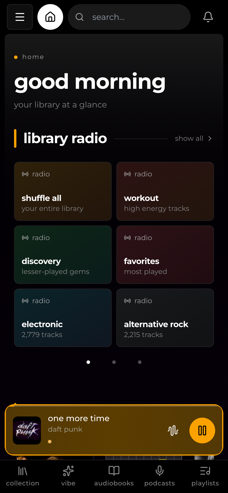

<div align="center">

# OxygenGS Kima Hub

**Your library. Your rules. Your vibe.**

A beautiful, self-hosted music experience — powered by Kima Hub v1.11.0, refined with OxygenGS branding, better control over user permissions, security hardening and English/Dutch interface options.

[](https://github.com/OxygenGS/kima-hub/releases)
[](https://github.com/OxygenGS/kima-hub/pkgs/container/kima-hub)
[](LICENSE)
[](docs/internationalization.md)

[**Get started**](#quick-start) · [**Explore features**](#what-you-get) · [**See the app**](#a-look-inside) · [**Documentation**](#documentation) · [**Releases**](https://github.com/OxygenGS/kima-hub/releases)

</div>

---

## Music, on your terms

Host your own music library, find what you love again and discover what to play next. Kima Hub brings together streaming, smart playlists, audio analysis, podcasts and audiobooks in one interface — without handing ownership of your collection to a streaming service.

<p align="center">
  
</p>

## What you get

| Your music, organized | Discovery that feels personal | A home for every device |
| :--- | :--- | :--- |
| Stream your own albums and playlists. Browse artists, queue tracks and adjust playback quality. | Rediscover favorites with **Discover Weekly**, **Stats**, **Mood Mixer** and the **Vibe Map**. | A responsive web app and installable PWA for desktop, mobile and supported TV layouts. |

### What makes the OxygenGS fork different

- **English + Dutch:** Switch the interface language from login, onboarding or Settings. Your song titles and stored library data stay untouched.
- **Permissions that really apply:** Admins can choose who may request albums or download tracks. The backend enforces these rights; hiding a button is never the only protection.
- **Your identity:** Administrators can customize the app name, tagline, accent color, logo and favicon.
- **Hardened services:** Tighter internal network and credential boundaries, non-root backend/audio service processes and improved audio-processing safeguards.
- **The full v1.11 experience:** Upstream [Kima Hub v1.11.0](https://github.com/Chevron7Locked/kima-hub/releases/tag/v1.11.0) features and library improvements are integrated into **one** OxygenGS app.

## A look inside

<table>
<tr>
<td align="center" width="50%">
  
  <br /><b>Explore your Vibe Map</b>
</td>
<td align="center" width="50%">
  
  <br /><b>Discover your listening patterns</b>
</td>
</tr>
<tr>
<td align="center">
  
  <br /><b>Mix music by mood</b>
</td>
<td align="center">
  
  <br /><b>Take your library with you</b>
</td>
</tr>
</table>

## Quick start

> **Before pulling a newly released image:** confirm that the [stable image publisher](https://github.com/OxygenGS/kima-hub/actions/workflows/docker-publish.yml) completed successfully. A GitHub release page can appear before GHCR finishes building its Docker images.

You need Docker, an existing folder with music, and storage for the persistent app data.

```bash
docker run -d \
  --name kima \
  -p 3030:3030 \
  -v /absolute/path/to/music:/music \
  -v kima_data:/data \
  --restart unless-stopped \
  ghcr.io/oxygengs/kima-hub:v1.11.0
```

Then visit **http://localhost:3030** to create your administrator account.

- **`/music`** — your library, mounted from the host.
- **`/data`** — your database, credentials, generated secrets and caches. **Preserve and back up this entire volume.**
- **`3030`** — the web interface. Internal application services do not require separate exposed ports.

Prefer Compose or Dockge? See the [installation guide](docs/install.md) and [production Compose example](docker-compose.prod.yml) (set `VERSION=v1.11.0` for this release).

### Updating an existing installation?

**Back up before upgrading.** Kima can migrate the database when it starts; switching back to an older image will **not** reverse that migration. For rollback, use an independent copy of the **original pre-upgrade** data volume.

Read the [safe update and restore guide](docs/safe-aio-updates.md) before changing any existing instance. The public fork release is separate from upgrades of individually managed installations.

## Documentation

| Get started | Manage and personalize | Explore and develop |
| :--- | :--- | :--- |
| [Install Kima](docs/install.md) | [Server configuration](docs/configuration.md) | [Using Kima](docs/using-kima.md) |
| [Safe upgrades & rollback](docs/safe-aio-updates.md) | [Administration](docs/administration.md) | [Integrations](docs/integrations.md) |
| [Security](docs/security.md) | [User permissions](docs/user-permissions.md) | [GPU acceleration](docs/gpu.md) |
| [Image security reports](docs/image-security.md) | [Instance branding](docs/instance-branding.md) | [Subsonic clients](docs/subsonic.md) |
| [Release notes](CHANGELOG.md) | [Language settings](docs/internationalization.md) | [Contributing](CONTRIBUTING.md) / [Development](docs/development.md) |

**Other:** [Privacy](PRIVACY.md) · [Responsible disclosure](SECURITY.md) · [GitHub releases](https://github.com/OxygenGS/kima-hub/releases) · [Issues](https://github.com/OxygenGS/kima-hub/issues)

## Acknowledgements and licensing

OxygenGS Kima Hub is an independently maintained fork of [**Kima Hub by Chevron7Locked**](https://github.com/Chevron7Locked/kima-hub). Credit for the original project, features, community contributions and upstream development belongs to Chevron7Locked and upstream contributors. This is **not** an official upstream release.

The application remains under the [GNU GPL v3.0](LICENSE). Included third-party libraries and machine-learning models retain their own applicable terms and attribution notices, including the original [UPF model notice](services/audio-analyzer/models/LICENSE-upf-models).

---

<div align="center">

**Built for music lovers who prefer owning their library.**

[OxygenGS](https://github.com/OxygenGS) · [Original Kima Hub](https://github.com/Chevron7Locked/kima-hub)

</div>
