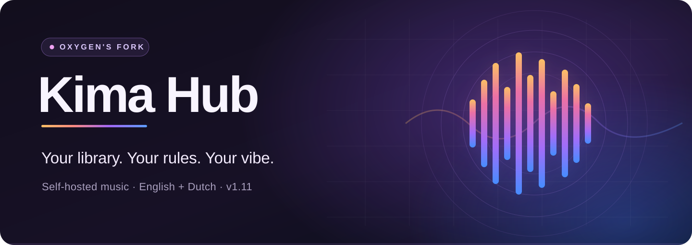
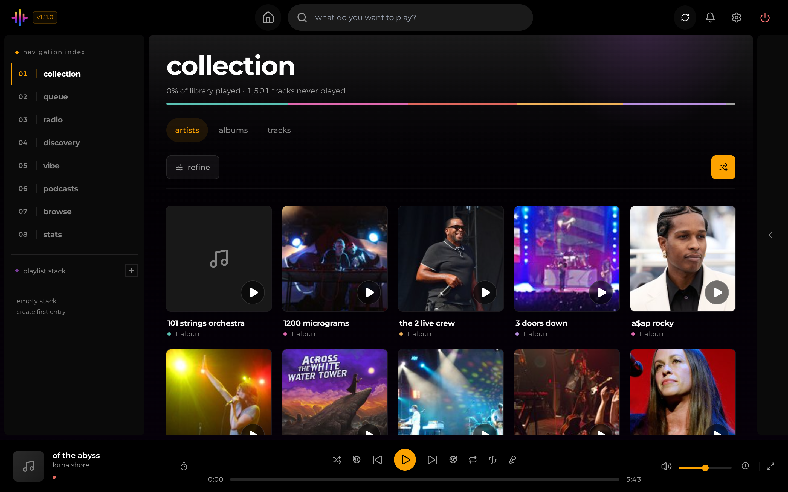
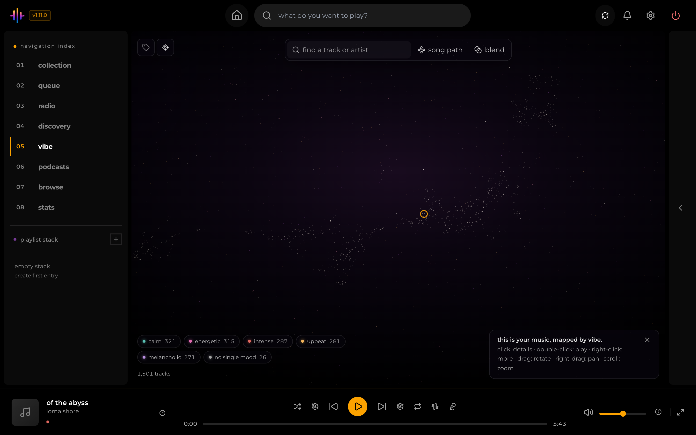
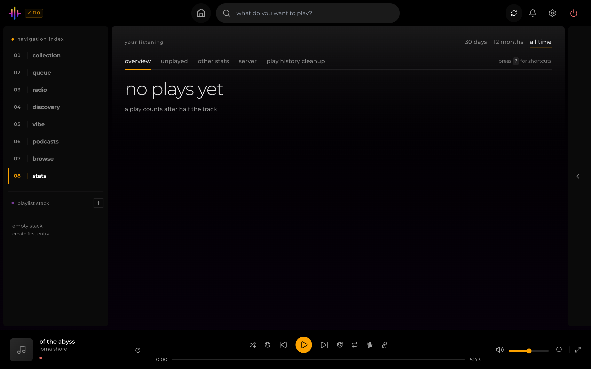
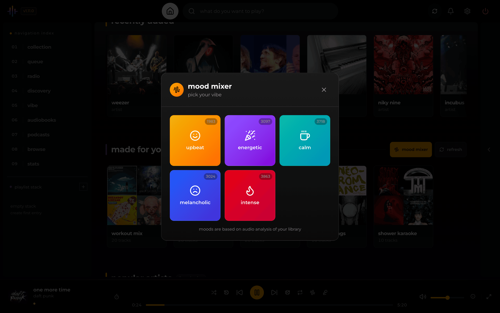

<div align="center">


<h1>Kima Hub · Oxygen's Fork</h1>



<p><strong>All the music you own. One beautifully self-hosted home.</strong></p>

<p>
  The Kima Hub v1.12 experience, refined with modern, legacy-free authentication for existing Symfonium and Feishin support,
  English/Dutch language settings, user permissions, Project Turbo performance improvements, UI 2.0 polish and security improvements.
</p>

<p>
  <a href="https://github.com/OxygenGS/kima-hub/releases"></a>
  <a href="https://github.com/OxygenGS/kima-hub/pkgs/container/kima-hub"></a>
  <a href="docs/internationalization.md"></a>
  <a href="LICENSE"></a>
</p>

<p>
  <a href="#quick-start"><b>Quick start</b></a> &nbsp;·&nbsp;
  <a href="#what-you-get"><b>Features</b></a> &nbsp;·&nbsp;
  <a href="#a-look-inside"><b>Screenshots</b></a> &nbsp;·&nbsp;
  <a href="#documentation"><b>Documentation</b></a>
</p>

</div>

---

## Music, on your terms

Host your music library, rediscover favorite tracks and find what to play next. Streaming, discovery, smart playlists, audio analysis, podcasts and audiobooks — all in one interface.

<p align="center">
  
</p>

## What you get

| Your music, organized | Discovery that feels personal | A home for every device |
| :--- | :--- | :--- |
| Stream your own albums and playlists. Browse artists, queue tracks and adjust playback quality. | Rediscover favorites with **Discover Weekly**, **Stats**, **Mood Mixer** and the **Vibe Map**. | A responsive web app and installable PWA for desktop, mobile and supported TV layouts. |

### What makes the OxygenGS fork different

- **Legacy-free client compatibility:** Kima already supported **Symfonium** and **Feishin**. The OxygenGS fork improves that existing integration: newly generated Native Apps API keys enable sign-in **without Legacy Authentication**, and Symfonium syncs **without Compatibility Mode** (verified on v1.12.0).
- **English + Dutch:** Switch the signed-in interface language in Settings. The login screen follows your browser preference but does not offer its own language selector. Music metadata stays untouched.
- **Permissions that really apply:** Admins can choose who may request albums or download tracks. The backend enforces these rights; hiding a button is never the only protection.
- **Your identity:** Administrators can customize the app name, tagline, accent color, logo and favicon.
- **Faster and smoother navigation:** Artist/album prefetching, concurrent artist detail loading, responsive loading skeletons, refined player/queue interactions and accessibility improvements.
- **Smaller Docker images:** Reduced redundant model-cache and frontend development layers for AMD64 and ARM64.
- **Hardened services:** Tighter internal network and credential boundaries, non-root backend/audio service processes and improved audio-processing safeguards.
- **The full v1.11 experience:** Upstream [Kima Hub v1.11.0](https://github.com/Chevron7Locked/kima-hub/releases/tag/v1.11.0) features and library improvements are integrated into **one** OxygenGS app.

### Improved Symfonium and Feishin compatibility

1. Update to a [verified published image](https://github.com/OxygenGS/kima-hub/releases/tag/v1.12.0).
2. In **Settings → Native Apps**, generate a **new API key** for each client. Keys made before v1.11.9 do not support salted-token login.
3. Add your Kima server in Symfonium or Feishin. Use the new key as the password; where supported, an API key can identify the account without a username.
4. Keep **Legacy Authentication off**. In Symfonium you can also leave **Compatibility Mode off**.

For details, see [OpenSubsonic client setup and authentication](docs/subsonic.md).

## A look inside

<p align="center">
  
  <br /><sub><b>Vibe Map</b> · Explore songs by how they sound and feel</sub>
</p>

<table>
  <tr>
    <td align="center" width="50%">
      
      <br /><sub><b>Listening Stats</b> · Discover your favorites</sub>
    </td>
    <td align="center" width="50%">
      
      <br /><sub><b>Mood Mixer</b> · Find the right sound</sub>
    </td>
  </tr>
</table>

<p align="center">
  
  <br /><sub><b>On the go</b> · Your library, wherever you listen</sub>
</p>

## Quick start

> **Before pulling a newly released image:** confirm that the [stable image publisher](https://github.com/OxygenGS/kima-hub/actions/workflows/docker-publish.yml) completed successfully. A GitHub release page can appear before GHCR finishes building its Docker images.

You need Docker, an existing folder with music, and storage for the persistent app data.

```bash
docker run -d \
  --name kima \
  -p 3030:3030 \
  -v /absolute/path/to/music:/music \
  -v kima_data:/data \
  --restart unless-stopped \
  ghcr.io/oxygengs/kima-hub:v1.12.0
```

Then visit **http://localhost:3030** to create your administrator account.

- **`/music`** — your library, mounted from the host.
- **`/data`** — your database, credentials, generated secrets and caches. **Preserve and back up this entire volume.**
- **`3030`** — the web interface. Internal application services do not require separate exposed ports.

Prefer Compose or Dockge? See the [installation guide](docs/install.md) and [production Compose example](docker-compose.prod.yml) (set `VERSION=v1.12.0` for this release).

### Updating an existing installation?

**Back up before upgrading.** Kima can migrate the database when it starts; switching back to an older image will **not** reverse that migration. For rollback, use an independent copy of the **original pre-upgrade** data volume.

Read the [safe update and restore guide](docs/safe-aio-updates.md) before changing any existing instance. The public fork release is separate from upgrades of individually managed installations.

## Documentation

| Get started | Manage and personalize | Explore and develop |
| :--- | :--- | :--- |
| [Install Kima](docs/install.md) | [Server configuration](docs/configuration.md) | [Using Kima](docs/using-kima.md) |
| [Safe upgrades & rollback](docs/safe-aio-updates.md) | [Administration](docs/administration.md) | [Integrations](docs/integrations.md) |
| [Security](docs/security.md) | [User permissions](docs/user-permissions.md) | [GPU acceleration](docs/gpu.md) |
| [Image security reports](docs/image-security.md) | [Instance branding](docs/instance-branding.md) | [Subsonic clients](docs/subsonic.md) |
| [Release notes](CHANGELOG.md) | [Language settings](docs/internationalization.md) | [Contributing](CONTRIBUTING.md) / [Upstream compatibility](docs/upstream-compatibility.md) |

**Other:** [Privacy](PRIVACY.md) · [Responsible disclosure](SECURITY.md) · [GitHub releases](https://github.com/OxygenGS/kima-hub/releases) · [Issues](https://github.com/OxygenGS/kima-hub/issues)

## Acknowledgements and licensing

OxygenGS Kima Hub is an independently maintained fork of [**Kima Hub by Chevron7Locked**](https://github.com/Chevron7Locked/kima-hub). Credit for the original project, features, community contributions and upstream development belongs to Chevron7Locked and upstream contributors. This is **not** an official upstream release.

The application remains under the [GNU GPL v3.0](LICENSE). Included third-party libraries and machine-learning models retain their own applicable terms and attribution notices, including the original [UPF model notice](services/audio-analyzer/models/LICENSE-upf-models).

---

<div align="center">

**Built for music lovers who prefer owning their library.**

[OxygenGS](https://github.com/OxygenGS) · [Original Kima Hub](https://github.com/Chevron7Locked/kima-hub)

</div>
