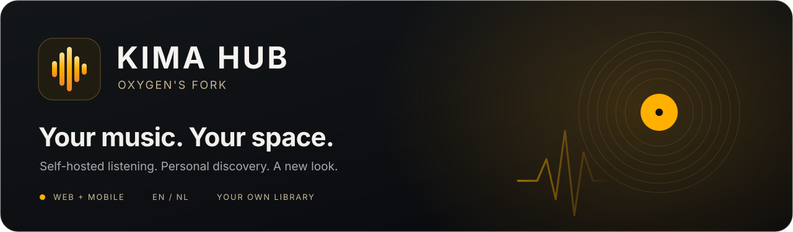

<div align="center">



# Kima Hub

### Your music. Your server. Your way to listen.

A modern, self-hosted music experience for the collection you own. Stream your library, discover new favorites, and stay in control of your data.

[](https://github.com/OxygenGS/kima-hub/releases/latest)
[](https://github.com/OxygenGS/kima-hub/pkgs/container/kima-hub)
[](docs/internationalization.md)
[](LICENSE)

**[Features](#everything-in-one-place) · [Artwork Recovery](#artwork-recovery) · [Install](#get-started) · [Native apps](#symfonium--feishin) · [Documentation](#documentation)**

</div>

---

## Latest stable release: v1.16.1

**Soulseek downloads fixed.** The current release restores P2P downloads in the all-in-one installation using a dedicated import folder, without granting write access to your entire music collection. Artwork Recovery and all existing listening features remain available.

[See what's new in v1.16.1](https://github.com/OxygenGS/kima-hub/releases/tag/v1.16.1) · [View the changelog](CHANGELOG.md)

## Everything in one place

| **Listen** | **Discover** | **Make it yours** |
| :--- | :--- | :--- |
| Browse your own artists, albums and tracks. Create playlists, organize your queue and enjoy responsive playback on desktop or mobile. | Explore Mood Mixer, Vibe Map, personalized recommendations, artist radio and listening statistics, powered by your own library. | Control user permissions, choose English or Dutch, adjust your instance branding and manage your media on your own server. |
| Lyrics, shuffle, repeat, seeking and a sleep timer support everyday listening. | Fast local-first artist pages, improved library search and clear loading states make browsing more natural. | Install the web app as a PWA where supported, or use compatible native music players through OpenSubsonic. |

Podcasts and optional Audiobookshelf, Lidarr and other integrations remain available when configured. Discovery features depend on library analysis and configured services.

## Artwork Recovery

<details open>
<summary><strong>Find more covers. Repair missing images. Keep your existing artwork.</strong></summary>

Kima looks for embedded album artwork first, then nearby image files named `cover`, `folder`, `front` or `album` (JPG, JPEG, PNG and WebP), followed by its existing external artwork providers.

For albums and artists already in your library, administrators can use **Settings → Artwork**:

| **Missing album covers** | **Missing artist photos** |
| :--- | :--- |
| Recover artwork for up to **200 albums per round**. Checks embedded and local files, then existing external sources. | Recover portraits for up to **100 artists per round**. Looks for local `artist.*` images and uses existing external sources if needed. |
| No full library rescan is required. | Album `folder.jpg` files are not mistaken for artist portraits. |

Both tools show progress, results and a continuation option. They **preserve manual image choices, good existing artwork and your music files**. Online providers may not have images for every item. An interrupted session can be started again; in-memory batch progress resets when the API restarts.

</details>

## Built on the original Kima, refined by this fork

- **Modern interface:** refreshed Home, artist and album pages, player, queue and navigation.
- **Faster browsing:** lightweight local artist loading, cached data, fewer unnecessary requests and bounded image processing.
- **Smarter local search:** exact-match priority, accent-aware queries and typo-tolerant fallback, alongside source-aware Library, Discover and P2P results.
- **Better native-client connections:** modern authentication and synchronization with Symfonium and Feishin, without requiring their older compatibility settings when using newly generated keys.
- **Administration that stays yours:** backend-enforced account permissions, instance-level branding and language settings.
- **Safer Soulseek downloads:** a dedicated `Singles/Kima Downloads` import folder for the non-root backend; existing music folders retain their permissions.
- **Release safeguards:** automated tests, upgrade/restore checks, AMD64/ARM64 builds, vulnerability scans and separate stable-release approval.

The fork retains the upstream music server, playback functionality and existing integrations. These improvements build on that foundation rather than replacing it.

## Get started

**Published image:** `ghcr.io/oxygengs/kima-hub:v1.16.1`
**Platforms:** `linux/amd64` and `linux/arm64`  
**Web and client API:** port `3030`

A single Docker container includes the web app, API, database, Redis and bundled analysis services.

```bash
docker run -d \
  --name kima \
  -p 3030:3030 \
  -v /absolute/path/to/music:/music \
  -v kima_data:/data \
  --restart unless-stopped \
  ghcr.io/oxygengs/kima-hub:v1.16.1
```

Replace `/absolute/path/to/music` with your music directory, then open `http://localhost:3030` on your Docker host and complete first-run setup.

| What to keep | Purpose |
| :--- | :--- |
| `/music` | Your own music files. Keep the correct host path mounted. |
| `/data` | Database, accounts, configuration, secrets and artwork cache. **Keep and back up the complete volume.** |
| Port `3030` | Web UI and client API; restrict access and use HTTPS for remote connections. |

**Docker Compose / Dockge**

Use the [production Compose example](docker-compose.prod.yml) with an explicit version:

```bash
MUSIC_PATH=/absolute/path/to/music VERSION=v1.16.1 docker compose -f docker-compose.prod.yml up -d
```

The example Compose files retain a conservative fallback image and do not automatically follow the newest release. The `:latest` tag is **not** automatically promoted. Pin a published version or immutable digest.

**Already running Kima?** Back up all persistent `/data` contents and verify a separate restore *before* upgrading. Keep the same volumes, mounts, and Compose project. Earlier releases may contain database migrations. The v1.16.1 hotfix adds no new schema migration. Follow the [safe upgrade and rollback guide](docs/safe-aio-updates.md).

[Full installation guide](docs/install.md) · [Safe upgrades](docs/safe-aio-updates.md)

## Symfonium & Feishin

Both clients were supported by the original Kima Hub. The OxygenGS fork improves authentication and synchronization.

1. Create a **new, separate API key** for each client under **Settings → Native Apps**.
2. Connect to your Kima server. Supply your account username when required and use the new API key as the password.
3. Keep **Legacy Authentication disabled**; Symfonium can also use **Compatibility Mode disabled**.

Older API keys may need replacement for modern salted-token authentication. Keep keys private and see [OpenSubsonic setup](docs/subsonic.md) for supported options and troubleshooting.

## Privacy, security and compatibility

Your library and account data stay on your own server. Restrict remote access, protect credentials and maintain independent backups.

Every stable release requires native multi-architecture build and security review. **Residual HIGH and CRITICAL dependency advisories remain in the documented prior image scan.** Successful CI does not guarantee zero vulnerabilities; consult the [image security report](docs/image-security.md) and the exact release's preflight before deployment.

[Security policy](SECURITY.md) · [Privacy policy](PRIVACY.md) · [Release validation](https://github.com/OxygenGS/kima-hub/actions/runs/41067045144)

## Documentation

| Start here | Manage | Explore |
| :--- | :--- | :--- |
| [Installation](docs/install.md) | [Administration](docs/administration.md) | [Using Kima](docs/using-kima.md) |
| [Safe updates](docs/safe-aio-updates.md) | [User permissions](docs/user-permissions.md) | [Native clients](docs/subsonic.md) |
| [Configuration](docs/configuration.md) | [Instance branding](docs/instance-branding.md) | [Integrations](docs/integrations.md) |
| [Latest releases](https://github.com/OxygenGS/kima-hub/releases) | [Image security](docs/image-security.md) | [Language settings](docs/internationalization.md) |

[Open an issue](https://github.com/OxygenGS/kima-hub/issues) · [Contribution guidelines](CONTRIBUTING.md) · [Upstream compatibility](docs/upstream-compatibility.md)

## Credits and license

This independently maintained fork is based on **[Kima Hub by Chevron7Locked](https://github.com/Chevron7Locked/kima-hub)**. Credit for the original application and existing integrations belongs to upstream developers and contributors. This repository is not an official upstream release.

Licensed under [GNU GPL v3.0](LICENSE). Third-party dependencies and machine-learning models retain their individual license terms, including the [model notice](services/audio-analyzer/models/LICENSE-upf-models).
