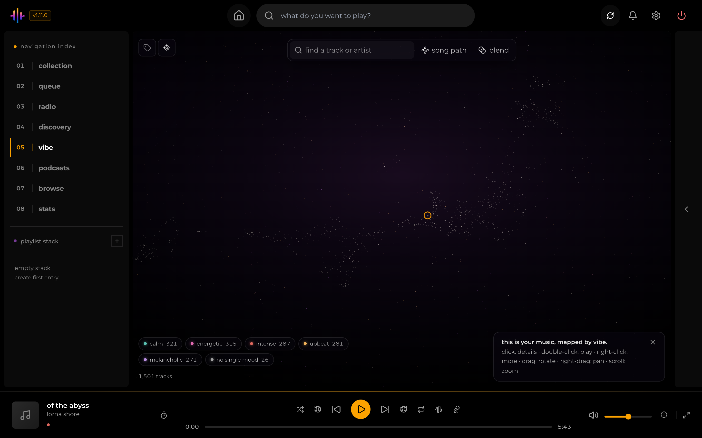
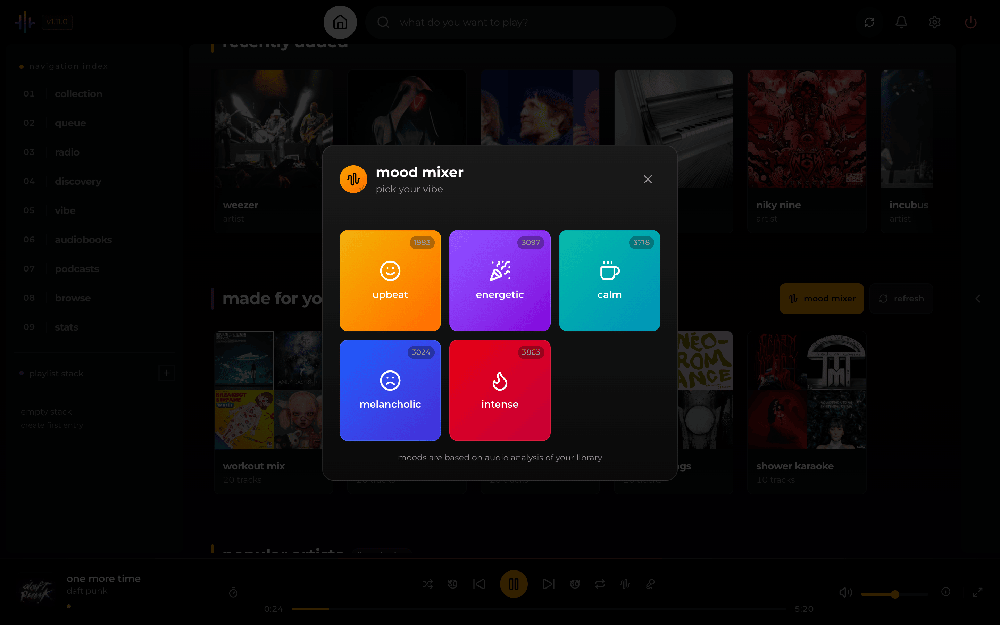
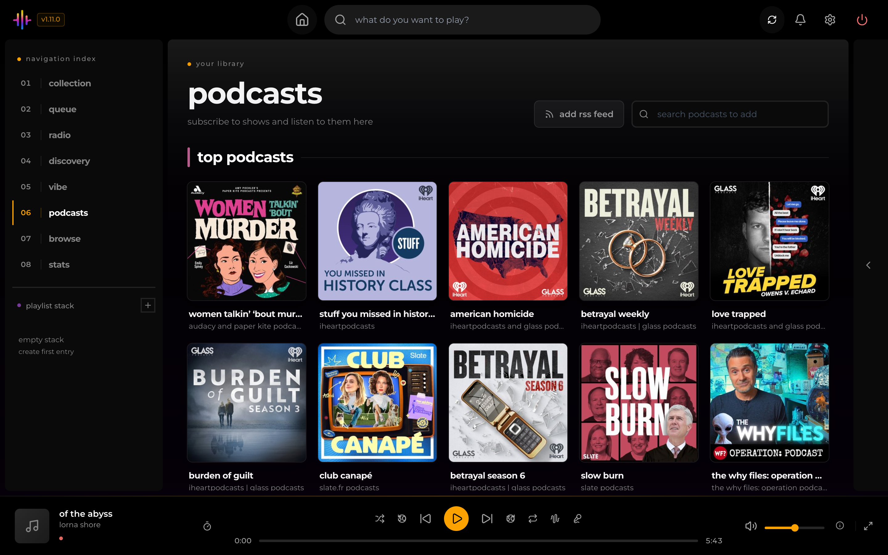
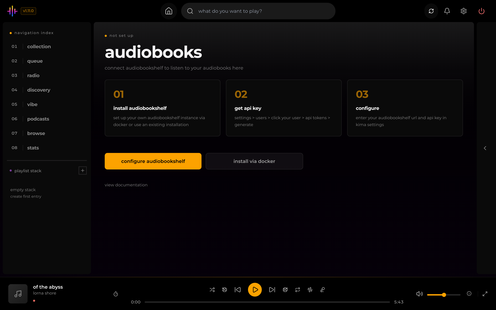
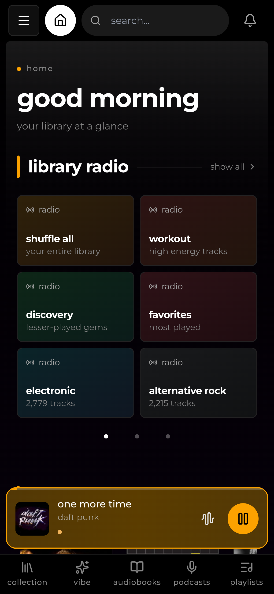
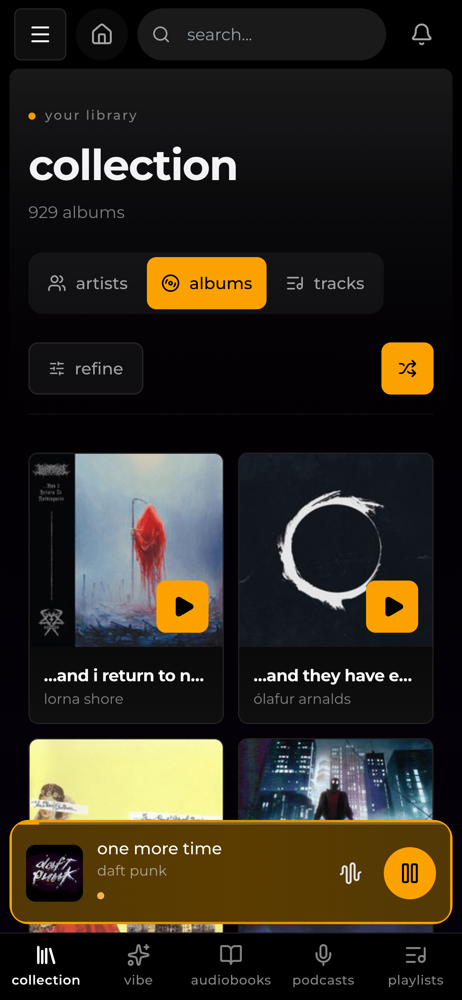

<div align="center">


# Kima Hub

**Your music. Your space. Your server.**

A self-hosted music experience that combines your own library with intelligent discovery, a polished dark interface, flexible playback and practical tools for managing music. Run it on your own infrastructure, connect the services you choose, and keep control of your collection.

[](https://github.com/OxygenGS/kima-hub/releases/tag/v1.27.0)
[](https://github.com/OxygenGS/kima-hub/pkgs/container/kima-hub)
[](https://github.com/OxygenGS/kima-hub/actions/workflows/docker-publish.yml)
[](docs/internationalization.md)
[](LICENSE)

**[What's new](#whats-new-in-v1270) · [Quick start](#quick-start) · [Experience](#the-experience) · [Features](#features) · [Integrations](#integrations) · [Documentation](#documentation)**


<sub>Home — your library, listening and discoveries together</sub>

</div>

---

## What's new in v1.27.0

[**v1.27.0 is available now.**](https://github.com/OxygenGS/kima-hub/releases/tag/v1.27.0) Released on **24 November 2026** for native Linux AMD64 and ARM64.

| New in v1.27.0 | What it means for you |
| :--- | :--- |
| **Personal appearance** | Choose original text capitalization and show or hide the desktop Browse shortcut. Preferences are stored per browser, without modifying library metadata. |
| **Audiobooks at your speed** | Choose 0.75×, 1×, 1.25×, 1.5×, 1.75× or 2× on desktop and mobile. The speed persists across chapter changes; music and podcasts remain at 1×. |
| **Safer Redis diagnostics** | Bounded, read-only AOF checks help investigate startup problems. No automatic file repair, deletion or queue wipe. |
| **OpenSubsonic improvements** | Recognized codec and MIME aliases produce more accurate direct-play reporting for compatible clients. |
| **Artist biography protection** | Empty or unavailable enrichment results no longer erase an existing artist description. |

This update introduces no new Prisma migration. An upgrade from an older release may still require earlier migrations.

[All v1.27.0 release notes](https://github.com/OxygenGS/kima-hub/releases/tag/v1.27.0) · [Full changelog](CHANGELOG.md) · [Safe updates](docs/safe-aio-updates.md)

## Quick start

**Current stable release:** [v1.27.0](https://github.com/OxygenGS/kima-hub/releases/tag/v1.27.0)

**Versioned image:** `ghcr.io/oxygengs/kima-hub:v1.27.0`

Kima's all-in-one Docker image includes the web interface, API, PostgreSQL, Redis and audio-analysis services. No separate database, Redis server, Lidarr or Audiobookshelf installation is required to listen to your own music.

**Requirements:** Docker on a compatible Linux AMD64 or ARM64 host, a real existing music directory and sufficient storage and memory for the database, artwork cache and audio analysis. The production Compose example allows 6 GiB RAM and 8 GiB combined memory and swap; resource use depends on library size and analysis settings. NVIDIA acceleration is optional.

### Docker — new installations

```bash
docker run -d \
  --name kima \
  --restart unless-stopped \
  -p 3030:3030 \
  --mount type=bind,source=/absolute/path/to/music,target=/music \
  --mount type=volume,source=kima_data,target=/data \
  ghcr.io/oxygengs/kima-hub:v1.27.0
```

Replace the example music path with your existing library directory. Docker's bind-mount syntax rejects a missing source instead of creating an empty directory. On NAS or DAS storage, independently verify that the intended filesystem is mounted.

Open `http://localhost:3030` on the Docker host, or the appropriate server address from another device on your network. Create the first administrator account and let Kima index and analyze your library. Advanced discovery becomes available as enrichment progresses.

### Docker Compose / Dockge — new installations

Use the [production Compose example](docker-compose.prod.yml) with an explicit image version and an existing music path:

```bash
MUSIC_PATH=/absolute/path/to/music VERSION=v1.27.0 \
  docker compose -f docker-compose.prod.yml up -d
```

For Dockge, use that production Compose file as your new stack and set the same environment variables. The file defaults to the published v1.27.0 image, requires `MUSIC_PATH` and prevents creation of a missing host music directory. The [optional companion stack](docker-compose.server.yml) adds download-management services; it is not required for Kima itself.

| Interface or mount | Purpose |
| :--- | :--- |
| `3030` | Web application and OpenSubsonic client API. |
| `/music` | Your existing music library. |
| `/data` | Database, accounts, generated secrets, settings, processing state and caches. Preserve this entire volume. |

[Complete installation guide](docs/install.md) · [Optional NVIDIA GPU setup](docs/gpu.md) · [Configuration](docs/configuration.md)

### Updating an existing installation

> [!IMPORTANT]
> Do not replace your existing stack with a new-install example. Keep the original Compose/Dockge project name, `/data` volume, media mounts and integration configuration.

1. Record the current image version and configuration privately. Stop data writers and make a **complete cold backup of /data**.
2. Verify restoration into a separate volume. Keep the original backup available for rollback.
3. Select the versioned v1.27.0 image in the same deployment. Pull it and redeploy through your existing Compose or Dockge workflow.
4. Verify login, playback, playlists, library data, downloads and integrations before retiring any old backup.

Do not use `docker compose down -v` to update an existing installation. Reverting a Docker image does not reverse a database migration. If rollback requires the original schema, restore the pre-upgrade data into an independent volume before starting the older image.

[Read the complete backup, upgrade and rollback procedure](docs/safe-aio-updates.md).

## The experience

### Discover your next favorite

**Kima Flow** is a simple way to discover music that is already in your library. Choose **My favorites**, **A bit of both** or **Surprise me**, tune Energy and Discovery, and preview a personalized mix before you start playback.

| Discovery feature | How it works |
| :--- | :--- |
| **Continuous Flow** | Extend a Flow queue as it runs low. Manual queue edits or switching listening mode stop automatic continuation without pausing music. |
| **Music DNA** | Give individual tracks reversible **More like this** or **Less like this** feedback. Preferences are private to each account. |
| **Discovery Radar** | On request, find similar artists beyond your playable library. |
| **Album Spotlight** | Preview source-backed albums or EPs from newly discovered artists. |
| **Library Radio & Mood Mixer** | Start genre, decade, favorite or mood-based listening sessions. |

Flow never starts playback merely because the server suggests a mix. Continuous Flow requires the originating browser to remain open. Radar and Album Spotlight never start downloads automatically.

For deeper exploration, the original **3D Vibe Map** remains available. Use Match Vibe, Similar, Song Path and Blend to find connections between tracks or shape a listening journey.

<table>
<tr>
<td width="50%" align="center"><sub>Vibe Map — explore audio similarity</sub></td>
<td width="50%" align="center"><sub>Mood Mixer — shape your session</sub></td>
</tr>
</table>

[Explore Flow and Vibe](docs/using-kima.md#kima-flow-v1260)

### Your library, beautifully organized

Explore artists, albums, tracks, personal collections and playlists without losing ownership of your files. Search your local library and discover music beyond it. Review listening statistics, recently added albums, favorites and personalized recommendations.

<table>
<tr>
<td width="50%" align="center"><sub>Browse your library</sub></td>
<td width="50%" align="center"><sub>Artist discography</sub></td>
</tr>
<tr>
<td width="50%" align="center"><sub>Album detail and tracks</sub></td>
<td width="50%" align="center"><sub>Your collection</sub></td>
</tr>
</table>

### Podcasts and audiobooks

Subscribe to podcasts, resume episodes and connect your Audiobookshelf library. Audiobook playback saves your listening position back to Audiobookshelf and supports the adjustable playback speed introduced in v1.27.0.

<table>
<tr>
<td width="50%" align="center"><sub>Podcasts</sub></td>
<td width="50%" align="center"><sub>Audiobooks</sub></td>
</tr>
</table>

### Desktop, mobile and TV

Use responsive desktop and mobile layouts, install Kima as a PWA through a compatible browser, or use the dedicated television-browser layout. No separate native Kima mobile application is required.

<table>
<tr>
<td width="33%" align="center"></td>
<td width="33%" align="center"></td>
<td width="33%" align="center"></td>
</tr>
<tr><td align="center"><sub>Home</sub></td><td align="center"><sub>Player</sub></td><td align="center"><sub>Library</sub></td></tr>
</table>

**Kima Connect** discovers active Kima browsers belonging to the same account. Use remote playback controls or offer a queue handoff; the receiving browser must explicitly choose **Play here**. Kima Connect is not synchronized multiroom audio or remote control of third-party OpenSubsonic clients.

[Kima Connect guide](docs/project-one.md) · [Mobile and TV](docs/using-kima.md#on-a-phone-or-a-tv)

Repository screenshots illustrate existing product features and may not reflect every detail of the current release.

## Features

| Area | Available in the published stable release |
| :--- | :--- |
| **Playback** | Queue, shuffle, repeat, lyrics, radio, sleep timer, keyboard shortcuts and selectable streaming quality. |
| **Music library** | Local audio files, artist and album pages, collections, search, metadata enrichment and personal statistics. |
| **Playlists** | Private or public playlists, drag-to-reorder, share links, supported URL imports and M3U imports. |
| **Discovery** | Flow, Continuous Flow, Music DNA, Discovery Radar, Album Spotlight, Vibe Map, Song Path, Blend and Mood Mixer. |
| **Media** | Podcast subscriptions, optional Audiobookshelf playback, audiobook speed and progress synchronization. |
| **Device continuity** | Kima Connect, browser-player discovery, remote controls and consent-based queue handoff. |
| **Downloads** | Per-account download history, optional Lidarr album requests, built-in Soulseek or external slskd, and import-status review. |
| **Library maintenance** | Library Doctor, Library Guardian, Smart Download Inbox, missing artwork repair and reversible supported album associations. |
| **Administration** | Separate accounts and roles, 2FA, client keys, branding, storage and enrichment controls, English/Dutch language selection. |
| **Client compatibility** | OpenSubsonic, including compatible clients such as Symfonium and Feishin. |

### Settings Studio

Settings are organized into **Personal, Appearance, Downloads & Services, Music Library, and Administration**. Find settings through desktop navigation search or mobile category selection. Only authorized administrators can change server-wide settings and integrations.

<div align="center">

<sub>Settings Studio — illustrated interface overview</sub>
</div>

[Settings Studio and configuration](docs/configuration.md) · [Appearance preferences](docs/using-kima.md#appearance-preferences-v1270) · [User permissions](docs/user-permissions.md)

### Library maintenance without automatic destructive actions

- **Library Doctor:** on-demand reports of indexed missing or corrupt tracks, missing artwork and review candidates.
- **Library Guardian:** admin-only evidence for possible duplicate recordings using indexed metadata, duration and acoustic evidence. It does not delete files, retag songs or prove byte-identical duplicates.
- **Smart Download Inbox:** review qualifying import and album associations; supported reversible database-only corrections remain explicit user actions.
- **Artwork repair:** bounded repair of missing covers and artist pictures, preserving manually chosen artwork.
- **Redis recovery:** read-only diagnostic guidance; persistent data is never automatically wiped to recover a startup failure.

[Library Doctor and Guardian](docs/library-doctor.md) · [Administration](docs/administration.md) · [Redis recovery](docs/redis-recovery.md)

## Integrations

Configure integrations from Settings Studio. Each is optional; Kima can serve a local music library without external download services.

| Service | Purpose |
| :--- | :--- |
| **Lidarr** | Request albums and follow your existing library-import workflow. |
| **Soulseek / slskd** | Search for individual tracks with the built-in client or an external slskd server. |
| **Audiobookshelf** | Access audiobook and podcast libraries and save listening position. |
| **OpenSubsonic** | Connect compatible clients using per-client keys from **Settings → Native Apps**. |
| **ListenBrainz** | Optional scrobbling and listening-related recommendations. |
| **Fanart.tv / AcoustID** | Optional artwork enrichment and audio identification. |

Playlist imports support M3U and links from supported music providers; tracks are matched to your library, with missing entries handled through configured services. Availability depends on providers and your permissions. Music requests and downloads should only be used for material you are authorized to obtain.

The experimental Downtify connector was retired in v1.21.0. Previously imported music and historical database records are preserved; a separate Downtify service is no longer required.

[Integration guide](docs/integrations.md) · [OpenSubsonic and native clients](docs/subsonic.md) · [Privacy](PRIVACY.md)

## Security and release quality

The versioned v1.27.0 image has completed the [native AMD64/ARM64 preflight](https://github.com/OxygenGS/kima-hub/actions/runs/45379839167), [explicit stable approval](https://github.com/OxygenGS/kima-hub/actions/runs/45384258511) and [multi-architecture Docker publication](https://github.com/OxygenGS/kima-hub/actions/runs/45384297510).

The tested source also passed backend/frontend checks, Security E2E, database migration and recovery, and actual historical upstream-image upgrade and rollback on synthetic test data. These tests are not a guarantee for every real installation or external service.

**Residual vulnerabilities remain:** the native v1.27.0 preflight reported **391 HIGH / 8 CRITICAL** findings on AMD64 and **390 HIGH / 8 CRITICAL** on ARM64, without a scanner-listed patched version. Publication and passing policy checks do not establish that the findings are safe or unreachable.

Use a versioned image, restrict unnecessary public exposure, keep the host and reverse proxy updated, protect credentials, and verify separately restorable cold backups. Do not rely on the moving `:latest` alias; Kima does not promote it automatically. Publishing a release never upgrades existing installations on its own.

[Image-security report](docs/image-security.md) · [Security policy](SECURITY.md) · [Privacy policy](PRIVACY.md) · [Safe AIO updates](docs/safe-aio-updates.md)

## Documentation

| Getting started | Operating your server |
| :--- | :--- |
| [Installation and upgrades](docs/install.md) | [Settings Studio and configuration](docs/configuration.md) |
| [Using Kima](docs/using-kima.md) | [Administration](docs/administration.md) |
| [Integrations](docs/integrations.md) | [Library health and repairs](docs/library-doctor.md) |
| [OpenSubsonic clients](docs/subsonic.md) | [Image security](docs/image-security.md) |
| [Kima Connect](docs/project-one.md) | [Backup and rollback](docs/safe-aio-updates.md) |
| [English and Dutch](docs/internationalization.md) | [Redis recovery](docs/redis-recovery.md) |
| [User permissions](docs/user-permissions.md) | [Optional GPU acceleration](docs/gpu.md) |
| [Branding](docs/instance-branding.md) | [Development](docs/development.md) |
| [Changelog](CHANGELOG.md) | [Upstream compatibility](docs/upstream-compatibility.md) |

## About the fork

OxygenGS Kima Hub is an independent community fork of [Kima Hub by Chevron7Locked](https://github.com/Chevron7Locked/kima-hub), not an official upstream release. The goal is a more polished and capable self-hosted listening experience while retaining practical compatibility with upstream improvements and independent installations.

Contributions and reproducible bug reports are welcome. See [contributing](CONTRIBUTING.md) and [issues](https://github.com/OxygenGS/kima-hub/issues). Do not include server addresses, credentials, database backups or private installation details in public reports.

Licensed under [GNU GPL v3.0](LICENSE). Original contributions and third-party components remain with their respective owners; see the [audio model notices](services/audio-analyzer/models/LICENSE-upf-models).

---

<div align="center">

**Your music. Your space. Your server.**

[Releases](https://github.com/OxygenGS/kima-hub/releases) · [Install](docs/install.md) · [Changelog](CHANGELOG.md)

</div>
